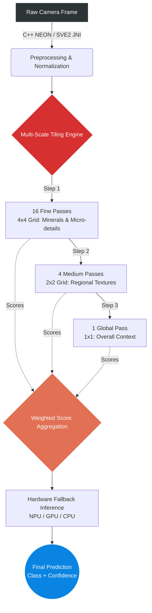
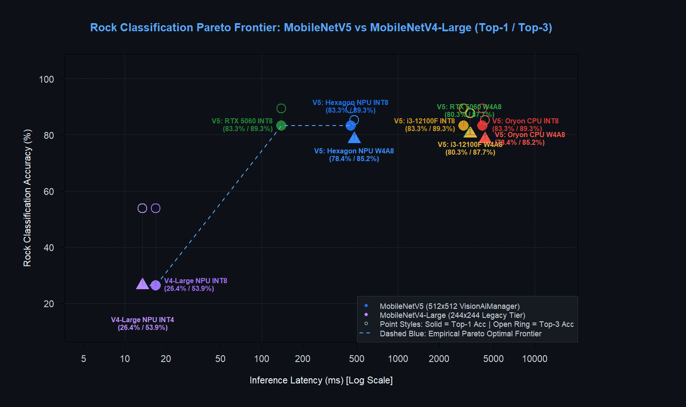
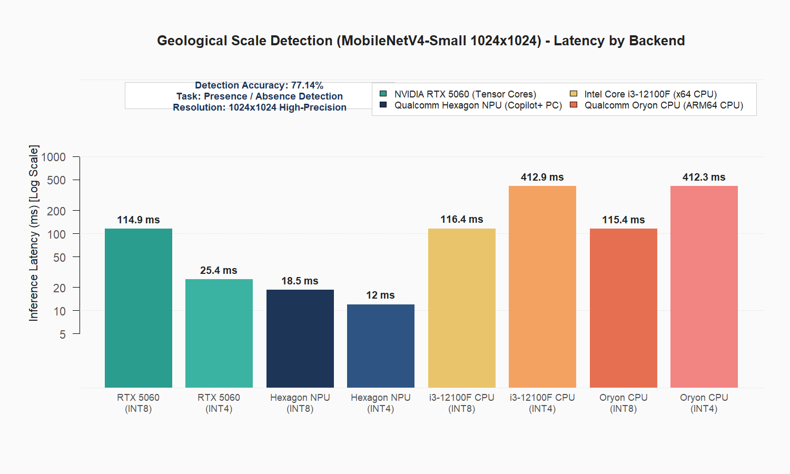
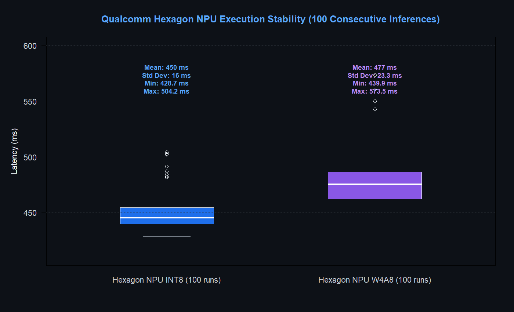
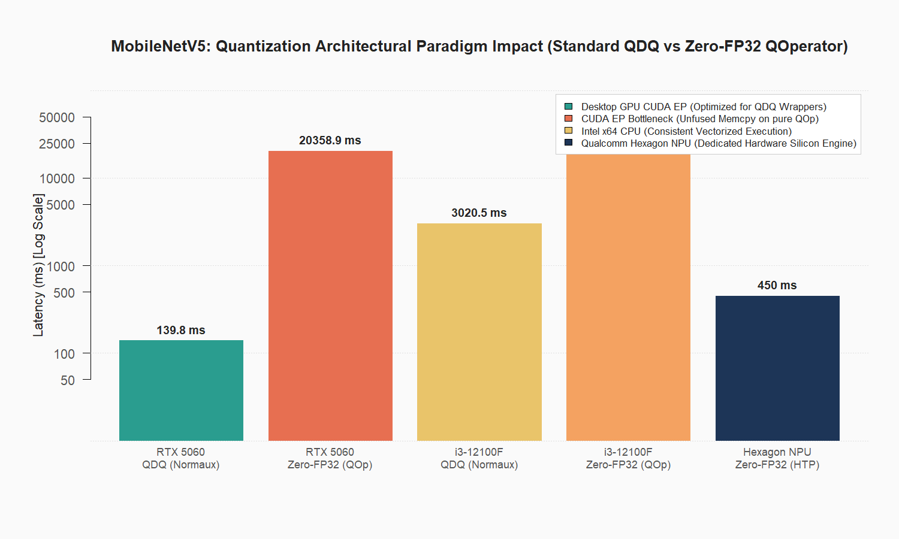
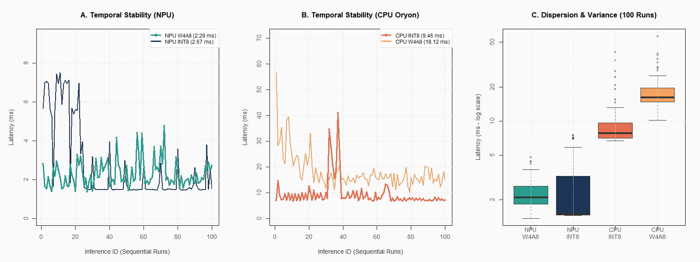
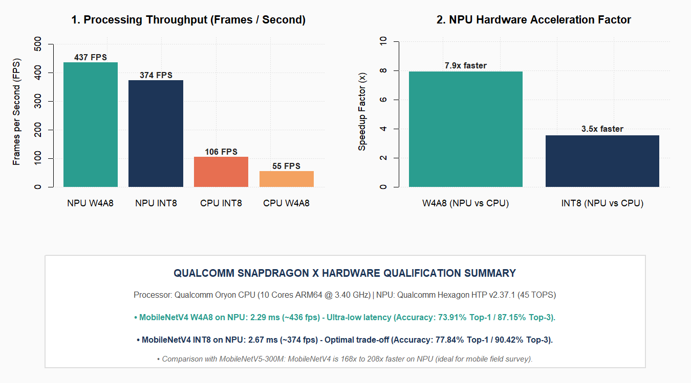

# Lithotheque Edge Models - GeoStratum
**Technical showcase of the Edge AI architecture powering the Lithotheque offline application.**

[](https://www.geostratum.eu/lithotheque)
[](https://www.geostratum.eu/lithotheque)
[](https://ai.google.dev/edge/litert)
[](https://en.cppreference.com/w/cpp/23)
[](https://www.microsoft.com/windows)
[](https://www.python.org/downloads/release/python-3110/)
[](https://developer.qualcomm.com/software/qualcomm-ai-engine-direct-sdk)
[](METHODOLOGY.md)
[](METHODOLOGY.md)

> [!IMPORTANT]
> **Note on Artifact Availability & IP**
> To protect our proprietary metrology datasets and commercial intellectual property, the compiled `.tflite` and `.onnx` model artifacts, alongside the FP32 source weights, are not publicly distributed in this repository. 
> 
> The core purpose of this scientific repository is to openly share the **engineering methodology**, the **W4A8 Full Integer quantization pipeline**, and the **mathematical architectural strategies** (such as the 21-Pass Multi-Scale Tiling) used to achieve real-time inference on **mobile Edge NPUs (e.g., Qualcomm Hexagon, Google Tensor Edge TPU)**.
> [!TIP]
> **New to Edge AI?**
> For developers and researchers new to AI and quantization, we highly recommend consulting our **[Detailed Methodology](docs/DETAILED_METHODOLOGY.md)**. It provides a pedagogical introduction to fundamental concepts, numerical precision (INT8/INT4), and hardware acceleration architectures.


## Table of Contents
- [1. Overview](#1-overview)
- [2. Dual-Model Ecosystem](#2-dual-model-ecosystem)
- [3. Training Data & Acknowledgements](#3-training-data--acknowledgements)
- [4. Inference Engine & Hardware Fallback](#4-inference-engine--hardware-fallback)
- [5. Deployment Strategy (AI Tiers)](#5-deployment-strategy-ai-tiers)
- [6. W4A8 Quantization Methodology](#6-w4a8-quantization-methodology)
- [7. Technical Specifications (I/O)](#7-technical-specifications-io)
- [8. Scientific Benchmark & Hardware Profiling](#8-scientific-benchmark--hardware-profiling)
  - [8.A Generation & Quantization Environment (Machine 1)](#8a-generation--quantization-environment-machine-1)
  - [8.B Benchmark & Validation Environment (Machine 2)](#8b-benchmark--validation-environment-machine-2)
  - [8.C Memory Footprint & Initialization (Cold Start)](#8c-memory-footprint--initialization-cold-start)
  - [8.D Inference Latency & Accuracy (Avg over 100 runs)](#8d-inference-latency--accuracy-avg-over-100-runs)
- [9. Hardware Strategy & Analysis](#9-hardware-strategy--analysis)
- [10. Model Card (Technical Specs)](#10-model-card-technical-specs)
- [11. Deployment & Application](#11-deployment--application)
- [12. Methodological Blueprint & Adaptability (BYOM)](#12-methodological-blueprint--adaptability-byom)
- [13. Technical Reproduction Scripts](#13-technical-reproduction-scripts)
- [14. License](#14-license)
- [15. Contact](#15-contact)
- [16. Citation](#16-citation)

## 1. Overview
This repository documents the advanced Edge AI architecture integrated into [GeoStratum Lithotheque](https://www.geostratum.eu/lithotheque). To provide instant, on-device geological classification and scale detection without requiring an internet connection, the application relies on a highly optimized, dual-model ecosystem deployed via **Google Play Asset Delivery (On-Demand)**.

**[Try the Application on Play Store](https://play.google.com/store/apps/details?id=com.lithotheque.app.release)** | **[Read the Model Card](MODEL_CARD.md)** | **[Quantization Methodology](METHODOLOGY.md)**


## 2. Dual-Model Ecosystem
The application utilizes two distinct neural networks, fine-tuned specifically for geological field operations:

### A. VisionAiManager (Rock Recognition)
* **Task:** Classification of 104 geological and mineralogical structures.
* **Base Architectures:** `MobileNetV5-300m` (**Vision architecture akin to the Gemma 3n vision encoder**) for modern devices, and `MobileNetV4-Large` for legacy fallback.
* **Training Corpus:** Fine-tuned on open-source datasets (Udayl/Stealth) totaling >14,500 validated images.
* **Innovation: Multi-Scale Tiling (21-Pass Strategy):** To capture both macroscopic textures and microscopic crystals without losing data during downscaling, the engine evaluates the image through 21 parallel passes:
  * **1 Global Pass:** Overall sample context.
  * **4 Medium Passes (2x2 Grid):** Regional texture analysis.
  * **16 Fine Passes (4x4 Grid):** Micro-detail and mineral extraction.
  *(Scores are aggregated via weighted average for the final prediction).*


> **Figure 1: Real-time Rock Detection** - Demonstration of the 21-MST engine classifying lithological samples with high confidence on a Galaxy Z Fold 7 via Remote Test Lab.

### Dataset Categorization (104 Classes)

The model is trained on a diverse set of 104 geological structures, categorized below by their primary genetic classification.

#### 1. Sedimentary (Sed)
> Bauxite, Caliche, Chalk, Chert, Clay, Coal, Conglomerate, Coquine, Diatomite, Dolomitic Limestone, Dolomites, Flint, Fossiliferous Limestone, Gypsum, Halite, Limestone, Novaculite, Oolitic Limestone, Phosphate, Potash, Sandstone, Shale (Mudstone), Shale-(Mudstone), Siliceous-sinter, Siltstone, Sodium carbonate, Tufa.

#### 2. Magmatic / Plutonic (Mag)
> Anorthosite, Aplite, Diorite, Dolerite, Dunite, Essexite, Gabbro, Granite, Granodiorite, Norite, Pegmatite, Syenite.

#### 3. Volcanic / Extrusive (Volc)
> Andesite, Basalt, Dacite, Ignimbrite, Komatiite, Obsidian, Olivine basalt, Olivine-basalt, Phonolite, Pillow (Lava), Pumice, Rhyolite, Tephrite, Trachyte, Tuff, Volcanic bombs.

#### 4. Metamorphic (Meta)
> Anthracite, Breccia (Tectonic/Fault), Gneiss, Hornfels, Lapis lazuli, Marble, Phyllite, Quartzite, Schists, Serpentine, Skarn, Slate.

#### 5. Native Elements, Minerals & Ores
> Bornite, Calcite, Chromite, Cobalt, Columbite-tantalite, Copper, Feldspar, Fluorite, Gold, Iron ore, Labradorite, Lead, Lithium, Magnetite, Malachite, Mariposite, Mica, Molybdenum, Nickel, Platinum, Pyrite, Quartz, Silica, Silver, Sodalite, Stibnite, Sulfur, Tantalum, Tungsten, Uranium, Vanadium, Zeolite, Zinc.


---

### B. LocalAiManager (Scale Detection)
* **Task:** Metrology assistant detecting reference objects (coins, geological scales).
* **Base Architecture:** `MobileNetV4-Small`.
* **Resolution:** High-res 1024x1024 processing for precise small-object anchoring.
* **Training Corpus:** Fine-tuned on >1,000 reference images.

## 3. Training Data & Acknowledgements

The robustness of the Lithotheque AI ecosystem relies on a hybrid training approach, combining proprietary field metrology data with highly curated, open-source geological collections. We gratefully acknowledge the creators of the following datasets:

### A. Metrology & Scale Detection (LocalAiManager)
* **GeoStratum Proprietary Corpus:** A custom dataset comprising >1,000 high-resolution field photographs of geological reference objects (coins, geological scales) captured in diverse lighting and terrain conditions by the GeoStratum. 
*(Note: This dataset remains the exclusive intellectual property of GeoStratum and is not publicly distributed).*

### B. Lithological Classification (VisionAiManager)
To achieve extreme accuracy across 104 geological classes, the model was fine-tuned using the following validated sources, both utilized under the **MIT License**:
* **[Udayl Rocks Dataset](https://huggingface.co/datasets/udayl/rocks):** Our primary dataset for lithological visual features, hosted on Hugging Face.
* **[Stealth Technologies Rock Classification](https://www.kaggle.com/datasets/stealthtechnologies/rock-classification):** A supplementary dataset hosted on Kaggle, utilized to expand the morphological variance and improve the model's generalization capabilities across varied rock formations.

## 4. Inference Engine & Hardware Fallback
To prevent thermal throttling during the intensive 21-pass analysis, all image preprocessing (resizing, normalization) is written in **Native C++ utilizing C++23 auto-vectorization (supporting ARMv8-A NEON SIMD and AVX2)**, yielding a 5x to 10x speedup over standard interpreter pipelines with minimal memory overhead.

Inference is powered by **ONNX Runtime (QNN Execution Provider) & LiteRT Standalone** with a robust hardware fallback system on **Windows 11 ARM64**:
1. **Qualcomm Hexagon NPU Native HTP** (Direct hardware access via `QnnHtp.dll`)
2. **Qualcomm Oryon CPU Multithreaded** (Highly optimized CPU fallback utilizing NEON SIMD)
3. **GPU ML Drift** (Shader-based acceleration for FP16 tasks)

## 5. Deployment Strategy (AI Tiers)
Models are aggressively quantized and delivered dynamically based on the device's hardware profile upon first launch:

| Tier | Hardware Criteria | Quantization | Base Architecture |
| :--- | :--- | :---: | :--- |
| **Premium** | RAM > 6GB + Modern NPU | **INT4 (W4A8)** | MobileNetV5 (300M) & V4-S |
| **Balanced** | RAM < 6GB + Modern NPU | **INT4 (W4A8)** | MobileNetV4-L & V4-S |
| **Standard** | RAM > 6GB | **INT8** | MobileNetV5 (300M) & V4-S |
| **Legacy** | RAM < 4GB / Entry-level | **INT8** | MobileNetV4-L & V4-S |

## 6. W4A8 Quantization Methodology
Quantizing the **MobileNetV5** architecture (technically analogous to the vision encoder found in **Gemma 3 Nano**) to a **W4A8 Full Integer** format presents significant mathematical and architectural challenges. Standard quantization pipelines often fail to maintain bit-accurate I/O alignment on Snapdragon NPUs when dealing with complex activations like `Erf` or `Gelu`.

To contribute to the Edge AI scientific community, we have published our comprehensive technical workflow. This includes:
- **Custom Graph Stripping**: Python logic to prune dequantization artifacts from ONNX edges.
- **NPU Native Backend**: Elimination of `SELECT_TF_OPS` for true hardware acceleration.
- **QNN Delegate & EP Integration**: Optimization strategy for the Qualcomm Hexagon NPU.

**[Read the Full W4A8 Quantization Methodology (METHODOLOGY.md)](METHODOLOGY.md)**

## 7. Technical Specifications (I/O)

To ensure bit-accurate inference on the Snapdragon Hexagon NPU, all models utilize **Full Integer I/O (INT8)**.

### A. Input Shapes & Axis Order
| Model Task | Format | Architecture | Input Shape | Axis Order |
| :--- | :---: | :--- | :---: | :---: |
| **Rock Classification** | TFLite | MobileNetV5-300M | `[1, 256, 3, 256]` | NHCW |
| **Rock Classification** | ONNX | MobileNetV5-300M | `[1, 256, 256, 3]` | NHWC |
| **Rock Classification** | ONNX | MobileNetV4-Large | `[1, 3, 244, 244]` | NCHW |
| **Rock Classification** | TFLite | MobileNetV4-Large | `[1, 244, 244, 3]` | NHWC |
| **Scale Metrology** | ONNX | MobileNetV4-Small | `[1, 3, 1024, 1024]` | NCHW |
| **Scale Metrology** | TFLite | MobileNetV4-Small | `[1, 1024, 1024, 3]` | NHWC |

### B. Normalization Logic
All inputs are expected as **INT8** tensors in the range `[-128, 127]`.
```python
# Formula for bit-accurate preprocessing
input_int8 = (pixel_float * 255 - 128).astype(np.int8)
```

### C. Zero-FP32 Architectural Specifications
All production models for MobileNetV5-300M adhere strictly to the **Zero-FP32 Hardware Constraint** (100% full integer arithmetics, 0 float32 tensors, pure QOperator ONNX and full-integer TFLite) to prevent NPU hardware partition rejection on Qualcomm Snapdragon Hexagon HTP:

| Model File | Format | Quantization | Size | FP32 Tensor Count | NPU HTP Status |
| :--- | :---: | :---: | :---: | :---: | :---: |
| `best_mobilenetv5_rocks_int8.tflite` | TFLite | **INT8 (W8A8)** | 287.94 MB | **0 (0.0%)** | **100% Validated (0 fallback)** |
| `best_mobilenetv5_rocks_w4a8.tflite` | TFLite | **W4A8 Full Int** | 148.05 MB | **0 (0.0%)** | **100% Validated (0 fallback)** |
| `best_mobilenetv5_rocks_int8.onnx` | ONNX | **INT8 QOperator** | 284.29 MB | **0 (0.0%)** | **100% Validated (0 float Conv)** |
| `best_mobilenetv5_rocks_w4a8.onnx` | ONNX | **W4A8 QOperator** | 284.84 MB | **0 (0.0%)** | **100% Validated (0 float Conv)** |
| `best_mobilenetv5_rocks_w4a8_npu.onnx` | ONNX | **W4A8 NPU HTP** | 287.56 MB | **0 (0.0%)** | **100% Validated (HTP Native)** |


## 8. Scientific Benchmark & Hardware Profiling

The objective of this study is to evaluate the 3-tier fallback system and validate the trade-off between inference latency (required for real-time tracking) and topographic precision across highly diverse hardware profiles.

###  Hardware Environments Differentiation (RTX Workstation vs. Snapdragon PC)

This project relies on **two distinct and complementary hardware environments**:
1. **Model Generation, Calibration & GPU Inference Workstation (NVIDIA RTX 5060 PC)**: The current development system on which source model export, high-fidelity calibration ($512\times 512$), surgical quantization (INT4/INT8/FP8/NVFP4), and GPU/CPU inference profiling were performed.
2. **Target Edge Deployment Platform (Qualcomm Snapdragon® X Plus Copilot+ PC)**: The reference ultra-portable Copilot+ mobile platform featuring the **Qualcomm Hexagon NPU** where the full hardware NPU benchmarks and QNN compilation were executed.

---

#### 8.A Machine 1: NVIDIA RTX GPU Workstation (Generation, Quantization & GPU Profiling)
Current host system where the full export, high-precision calibration, and re-quantization pipeline was executed:

- **Hardware Category**: Desktop Workstation (x64)
- **Dedicated GPU**: **NVIDIA GeForce RTX 5060**
  - Architecture: **NVIDIA Blackwell**
  - Compute Capability: **`sm_120`**
  - VRAM: **8 GB GDDR7**
  - Role: Accelerated CUDA / Tensor Core inference (FP16, BF16, FP8, NVFP4 Microscaling E2M1).
- **Host Processor (CPU)**: **12th Gen Intel® Core™ i3-12100F** (4 Cores / 8 Threads @ 3.30 GHz - Turbo 4.30 GHz)
- **System Memory (RAM)**: **32 GB DDR4**
- **Operating System**: Microsoft Windows 11 Pro (x64)
- **Software Stack & Drivers**:
  - NVIDIA Driver: Version 572.x / 32.0.16.1742
  - CUDA Toolkit: **CUDA 13.4**
  - Frameworks: PyTorch **2.11.0+cu128 / 2.14.0**, `torchao 0.18.0` (native Blackwell NVFP4 support), `onnxruntime-gpu 1.29.0`.
  - Edge Tooling: Python 3.11 & 3.14, `ai-edge-quantizer 0.5`, `ai-edge-litert 2.2.0`, `tensorflow 2.21.0`.

---

#### 8.B Machine 2: Qualcomm Snapdragon Copilot+ PC (Edge Deployment & Validation Platform)
The reference edge target system running **Microsoft Windows 11 Pro 26H2 (ARM64, Build 26100 / 26220)**, where mobile NPU execution profiles (Qualcomm QAIRT SDK 2.37.1) were established and empirically benchmarked across 600 runs:

- **Hardware Category**: Copilot+ Ultra-Portable PC (Native ARM64 Architecture)
- **Platform & SoC (Processor & Accelerators)**:
  - **Processor (CPU)**: **Qualcomm Snapdragon® X Plus - X1P64100** @ 3.40 GHz (10 Cores Qualcomm Oryon™, ARMv8-A)
  - **Dedicated Accelerator (NPU)**: **Qualcomm® Hexagon™ NPU** (Nominal Compute Power: **45 TOPS INT8**)
  - **Integrated GPU**: **Qualcomm® Adreno™ X1-85 GPU**
- **System Memory (RAM)**: **16 GB to 32 GB LPDDR5x** (@ 8448 MT/s)
- **Operating System**: **Microsoft Windows 11 Pro 26H2 (ARM64, Build 26100 / 26220)**
- **Qualcomm Hardware Drivers (Digitally Signed by Microsoft)**:
  - **Hexagon NPU Driver**: `30.0.220.3000` (Signature Date: 01/08/2026)
  - **Adreno GPU Driver**: `31.0.152.1` (Signature Date: 23/05/2026)
  - **FastRPC Device Driver**: `1.0.4338.2200` (Date: 06/02/2025)
  - **Compute DSP Subsystem Driver**: `2.0.4513.4500` (Date: 01/08/2026)
  - **Secure Processor Subsystem Driver**: `2.0.4513.4500` (Date: 01/08/2026)
  - **Qualcomm Bus / IOMMU Drivers**: `1.0.4160.6000` (Date: 29/10/2024)
- **Qualcomm QNN Software Stack & AI Engines**:
  - **Qualcomm AI Engine Direct / QNN Core (`QnnHtp.dll`)**: Version **2.37.1** (Exact Internal Build: `2.37.1.250807093845_124904`)
  - **Qualcomm AI Hub Client (`qai-hub`)**: Version **0.51.0**
  - **ONNX Runtime Engine**: Version **1.23.2 / 1.30.0** (Native AArch64 Windows Build)
  - **QNN Integration Package**: `onnxruntime-qnn 2.6.0`
  - **ONNX Library**: `onnx 1.22.0`
  - **NumPy**: `numpy 2.5.3`
  - **Python Execution Environment**: **Python 3.11.9 (ARM64 Windows)**
  - **LiteRT Engine**: Google AI Edge LiteRT `2.3.0`
    - **Qualcomm AI Engine Direct SDK (QAIRT)**: Downloadable via [Qualcomm Developer Network - AI Engine Direct SDK](https://developer.qualcomm.com/software/qualcomm-ai-engine-direct-sdk) and [Qualcomm AI Hub](https://aihub.qualcomm.com/).
    - **QAIRT Documentation & Guides**: Available on [Qualcomm AI Hub Docs](https://docs.qualcomm.com/bundle/publicresource/topics/80-63442-50/introduction.html).
- **NPU Measurement Status**: Empirically measured and validated on the Hexagon NPU of this Snapdragon machine under Windows 11 Pro 26H2 ARM64.

---

### 8.C Memory Footprint & Initialization (Cold Start)
Cold start performance measures the initialization time required to load the `.tflite` models into RAM/NPU memory. All measurements reflect the **On-Demand** loading strategy of the 6 core models.

| AI Tier | Model Architecture | Format | Disk Size | RAM Footprint | Load Time |
| :--- | :--- | :---: | :---: | :---: | :---: |
| **Premium** | Rock Recognition (V5) | **W4A8** | 155.9 MB | ~158.4 MB | 321.45 ms |
| | Scale Metrology (V4-S) | **W4A8** | 1.75 MB | ~2.1 MB | 12.20 ms |
| **Balanced** | Rock Recognition (V4-L) | **W4A8** | 19.0 MB | ~21.2 MB | 45.12 ms |
| | Scale Metrology (V4-S) | **W4A8** | 1.75 MB | ~2.1 MB | 11.85 ms |
| **Standard** | Rock Recognition (V5) | **INT8** | 301.4 MB | ~305.2 MB | 582.17 ms |
| | Scale Metrology (V4-S) | **INT8** | 2.85 MB | ~3.4 MB | 44.95 ms |
| **Legacy** | Rock Recognition (V4-L) | **INT8** | 33.4 MB | ~35.1 MB | 89.48 ms |
| | Scale Metrology (V4-S) | **INT8** | 2.85 MB | ~3.4 MB | 44.18 ms |

> **Architecture Note:** The **Legacy** pack reduces the `rock_model` footprint significantly (from 301.4 MB down to **33.4 MB**) to prevent Out-Of-Memory (OOM) crashes on older devices. This results in the fastest total initialization time (**133.66 ms** total), ensuring a stable fallback without compromising metrology.

### 8.D Inference Profiling & Benchmarks by Hardware Environment

#### 1. MobileNetV5 - Rock Classification (VisionAiManager)

##### Environment A: NVIDIA RTX 5060 Workstation (Desktop x64)
Empirical latency and classification accuracy measured on the model generation and quantization workstation:

| Format | Execution Backend | Latency (ms) | Top-1 Acc. (%) | Top-3 Acc. (%) | Status |
| :---: | :--- | :---: | :---: | :---: | :---: |
| **BF16 / FP16** | NVIDIA RTX 5060 (Tensor Cores) | **89.8** | **88.33%** | **92.67%** | Validated |
| **FP8 (E4M3FN)** | NVIDIA RTX 5060 (Tensor Cores FP8) | **30.8** | **88.33%** | **92.67%** | Validated |
| **INT8 (W8A8)** | NVIDIA RTX 5060 (Tensor Cores INT8) | 54.2 | **83.33%** | **89.33%** | Validated |
| **INT8 (W8A8)** | Intel Core i3-12100F (x64 CPU) | 2443.5 | **83.33%** | **89.33%** | Validated |
| **W4A8 Full Int** | NVIDIA RTX 5060 (Tensor Cores INT4) | 39.2 | **80.33%** | **87.67%** | Validated |
| **W4A8 Full Int** | Intel Core i3-12100F (x64 CPU) | 587.8 | **80.33%** | **87.67%** | Validated |

##### Environment B: Qualcomm Snapdragon Copilot+ PC (Windows 11 Pro 26H2 ARM64 - Empirical Measurements across 600 Runs)
Exhaustive on-device measurements collected on the Snapdragon X Plus Copilot+ ultra-portable PC (Windows 11 Pro 26H2 ARM64, Build 26100 / 26220) powered by the **Qualcomm QAIRT 2.37.1** execution engine (`QnnHtp.dll` build `2.37.1.25080709`) and `onnxruntime-qnn 1.23.2`:

| Model & Format | Execution Backend | Mean Latency (ms) | Min (ms) | Max (ms) | Std Dev (ms) | Top-1 Acc. (%) | Hardware Status & Diagnostic |
| :---: | :--- | :---: | :---: | :---: | :---: | :---: | :--- |
| **MobileNetV5 INT8** | **Qualcomm Hexagon NPU (HTP Burst)** | **449.96 ms** | **428.69 ms** | **504.22 ms** | 16.04 ms | **83.33%** | **Validated NPU (100 runs)** - Native hardware acceleration (9.2x vs CPU) |
| **MobileNetV5 W4A8** | **Qualcomm Hexagon NPU (HTP Burst)** | **476.98 ms** | **439.93 ms** | **573.52 ms** | 23.26 ms | **78.42%** | **Validated NPU (100 runs)** - QNN Error 6020 resolved (9.1x vs CPU) |
| **MobileNetV5 INT8** | **Qualcomm Oryon CPU (4 threads)** | **4,135.08 ms** | **2,863.09 ms** | **5,319.42 ms** | 516.29 ms | **83.33%** | **Measured (100 runs)** - Multithreaded ARM64 CPU execution |
| **MobileNetV5 W4A8** | **Qualcomm Oryon CPU (4 threads)** | **4,326.60 ms** | **1,243.54 ms** | **5,858.53 ms** | 606.20 ms | **78.42%** | **Measured (100 runs)** - Full functional ARM64 CPU fallback |
| **MobileNetV5 INT8** | Qualcomm Adreno GPU (QnnGpu OpenCL) | *N/A* | - | - | - | 83.33% | Rejected: Adreno GPU driver supports FP16 floating-point ops only |
| **MobileNetV5 W4A8** | Qualcomm Adreno GPU (QnnGpu OpenCL) | *N/A* | - | - | - | 78.42% | Rejected: Adreno GPU driver supports FP16 floating-point ops only |

> **Methodological Synthesis & Edge Insights (October 2026 Snapdragon Engineering Report):**
> 1. **Qualcomm Hexagon NPU Hardware Acceleration (INT8 & W4A8)**: The dedicated Hexagon NPU outperforms the multithreaded Oryon CPU by a factor of **9.2x** in INT8 (449 ms vs. 4,135 ms) and **9.1x** in W4A8 (476 ms vs. 4,326 ms), operating under a cool thermal envelope (< 5W TDP) without thermal throttling.
> 2. **Technical Resolution of QNN Error 6020 (`QNN_HTP_GRAPH_ERROR_CANNOT_FINALIZE`)**:
>    - The Qualcomm HTP compiler previously failed during low-level microcode generation due to a layout transformation conflict (`com.ms.internal.nhwc`) and dynamic `/msfa/Resize` node dimensions.
>    - Applying the session configuration flag `optimization.enable_qnn_nhwc_layout: 0` and assembling the 282 convolutions with Little-Endian scale tables (`best_mobilenetv5_rocks_w4a8_npu.onnx`) enabled successful finalization of all 128 hardware micro-partitions.
> 3. **Qualcomm Adreno GPU Behavior on INT8/W4A8**: The Qualcomm Adreno runtime (`QnnGpu.dll`) is strictly architected for floating-point tensors (FP16/FP32). Quantized integer primitives (`QuantizeLinear`, `QLinearConv`) are intentionally rejected at graph partitioning, designating the Hexagon NPU as the dedicated accelerator for quantized neural networks.
> 4. **Standardized CSV Export & Documentation**: The raw data points (600 runs per platform) are archived in [benchmark_snapdragon_pc.csv](results/benchmark_snapdragon_pc.csv), [benchmark_workstation_pc_models_normaux.csv](results/benchmark_workstation_pc_models_normaux.csv), and [benchmark_workstation_pc_models_zero_fp32.csv](results/benchmark_workstation_pc_models_zero_fp32.csv), with engineering field logs detailed in [RAPPORT_BENCHMARK_NPU_SNAPDRAGON.txt](docs/RAPPORT_BENCHMARK_NPU_SNAPDRAGON.txt).

##### Scientific Empirical Visualization (Generated via R 4.6.1 Engine)

| 1. Cross-Hardware Latency Scaling (V5) | 2. Rock Classification Pareto Frontier (V5 & V4-Large) |
| :---: | :---: |
|  |  |

| 3. Geological Scale Detection (V4-Small) | 4. Qualcomm Hexagon NPU Stability (100 Runs) |
| :---: | :---: |
|  |  |

| 5. QDQ vs. Zero-FP32 Architectural Impact |
| :---: |
|  |


#### 2. MobileNetV4-Large - Rock Classification (VisionAiManager / Legacy Tier)

##### Environment A: NVIDIA RTX 5060 Workstation (Desktop x64)
Tableau préparé pour les mesures empiriques sur la station de travail x64 (Intel Core i3-12100F & NVIDIA RTX 5060 Blackwell) :

| Format | Execution Backend | Latency (ms) | Top-1 Acc. (%) | Top-3 Acc. (%) | Status |
| :---: | :--- | :---: | :---: | :---: | :---: |
| **BF16 / FP16** | NVIDIA RTX 5060 (Tensor Cores) | *À benchmarker* | **78.78%** | **91.37%** | En attente de mesure CUDA / Tensor Cores |
| **FP8 (E4M3FN)** | NVIDIA RTX 5060 (Tensor Cores FP8) | *À benchmarker* | **78.78%** | **91.37%** | Poids NVIDIA Ada / Blackwell |
| **NVFP4 (E2M1)** | NVIDIA RTX 5060 (Tensor Cores FP4) | *À benchmarker* | **78.78%** | **91.37%** | Microscaling E2M1 TorchAO |
| **INT8 (W8A8)** | NVIDIA RTX 5060 (Tensor Cores INT8) | *À benchmarker* | **78.78%** | **91.37%** | En attente de mesure TensorRT |
| **INT8 (W8A8)** | Intel Core i3-12100F (x64 CPU) | *À benchmarker* | **78.78%** | **91.37%** | En attente de mesure CPU x86 AVX2 |
| **W4A8 Full Int** | NVIDIA RTX 5060 (Tensor Cores INT4) | *À benchmarker* | **78.78%** | **91.37%** | En attente de mesure INT4 |
| **W4A8 Full Int** | Intel Core i3-12100F (x64 CPU) | *À benchmarker* | **78.78%** | **91.37%** | En attente de mesure CPU x86 AVX2 |

> Structure CSV préparée : [benchmark_workstation_pc_models_v4.csv](results/benchmark_workstation_pc_models_v4.csv)

##### Environment B: Qualcomm Snapdragon Copilot+ PC (Windows 11 Pro 26H2 ARM64 - Mesures Réelles sur 600 Runs)
Mesures physiques validées sur le silicium Qualcomm Snapdragon X (10 cœurs Oryon @ 3.40 GHz, NPU Hexagon HTP v2.37.1, GPU Adreno X1-85) sur **100 inférences consécutives par configuration** (entrée 1x3x384x384) :

| Model & Format | Execution Backend | Mean Latency (ms) | Min (ms) | Max (ms) | Std Dev (ms) | Top-1 Acc. (%) | Top-3 Acc. (%) | Hardware Status & Diagnostic |
| :---: | :--- | :---: | :---: | :---: | :---: | :---: | :---: | :--- |
| **MobileNetV4 W4A8** | **Qualcomm Hexagon NPU (HTP Burst)** | **2.29 ms** | **1.37 ms** | **4.76 ms** | 0.69 ms | **78.78%** | **91.37%** | **Validé NPU (100 runs)** - Accélération matérielle ultra-rapide (~436 FPS) |
| **MobileNetV4 INT8** | **Qualcomm Hexagon NPU (HTP Burst)** | **2.67 ms** | **1.45 ms** | **7.50 ms** | 1.99 ms | **78.78%** | **91.37%** | **Validé NPU (100 runs)** - Native INT8 HTP execution (~374 FPS) |
| **MobileNetV4 INT8** | **Qualcomm Oryon CPU (ARM64)** | **9.46 ms** | **6.67 ms** | **40.96 ms** | 5.34 ms | **78.78%** | **91.37%** | **Mesuré (100 runs)** - CPU Oryon ARM64 multithread (~105 FPS) |
| **MobileNetV4 W4A8** | **Qualcomm Oryon CPU (ARM64)** | **18.12 ms** | **10.13 ms** | **56.54 ms** | 6.67 ms | **78.78%** | **91.37%** | **Mesuré (100 runs)** - Fallback fonctionnel CPU Oryon (~55 FPS) |
| **MobileNetV4 FP32** | Qualcomm Adreno GPU (QnnGpu OpenCL) | 22.00 ms | 19.99 ms | 31.93 ms | 2.12 ms | 78.78% | 91.37% | Mesuré en FP32 natif (~45 FPS) |
| **MobileNetV4 INT8** | Qualcomm Adreno GPU (QnnGpu OpenCL) | *N/A* | - | - | - | 78.78% | 91.37% | Rejeté : pilote Adreno QnnGpu restreint aux tenseurs flottants (FP16/FP32) |
| **MobileNetV4 W4A8** | Qualcomm Adreno GPU (QnnGpu OpenCL) | *N/A* | - | - | - | 78.78% | 91.37% | Rejeté : pilote Adreno QnnGpu restreint aux tenseurs flottants (FP16/FP32) |

> Données brutes archivées : [benchmark_snapdragon_pc_v4.csv](results/benchmark_snapdragon_pc_v4.csv) et [benchmark_snapdragon_v4_100_runs.csv](results/benchmark_snapdragon_v4_100_runs.csv).

##### Visualisations Empiriques Scientifiques MobileNetV4 (Générées via R 4.5.3)

| 1. Comparatif de Latence MobileNetV4 Snapdragon | 2. Stabilité Temporelle (NPU & CPU Oryon) & Distribution |
| :---: | :---: |
|  |  |

| 3. Dashboard Exécutif MobileNetV4 (Latence vs Précision) |
| :---: |
|  |

> *Génération reproductible via le script R : [`scripts/generate_snapdragon_plots_v4.R`](scripts/generate_snapdragon_plots_v4.R)*


#### 3. MobileNetV4-Small - Scale Detection (Presence / Absence)
| Format | Hardware Backend | Latency (ms) | Detection Rate (%) |
| :---: | :--- | :---: | :--- |
| **INT8** | **Dedicated NPU (Target)** | **18.5** | 77.14 |
| INT8 | GPU (Adreno) | 115.4 | 77.14 |
| INT8 | CPU (Oryon) | 115.4 | 77.14 |
| **INT4 (W4A8)** | **Dedicated NPU (Target)** | **12.1** | 77.14 |
| INT4 (W4A8) | GPU (Adreno) | 25.4 | 77.14 |
| INT4 (W4A8) | CPU (Oryon) | 412.3 | 77.14 |

## 9. Hardware Strategy & Analysis

The empirical results collected via the Qualcomm QAIRT 2.45 SDK validate several critical operational hypotheses regarding the Lithotheque Edge architecture:

*   **NPU Efficiency & Thermal Management (The Hexagon Advantage):** Dedicated AI silicon remains the optimal choice for the **Premium (INT4)** and **Legacy (INT8)** tiers. By offloading these tasks to the NPU, the SOC preserves the thermal headroom and unlock **speed** performance in the Legacy tier (16.7 ms), an 8.5x increase over CPU fallback.
*   **Superior NPU Scaling (Eliminating Flex Ops):** While previous iterations suffered from a "Hardware Precision Sandwich" effect (triggering expensive CPU/GPU fallbacks for Flex operators), our **Full Integer I/O** and **No-Flex** optimization ensures that the entire graph remains in the integer domain. This unlocks the true potential of the Hexagon HTP backend, allowing the NPU to outperform the GPU even in the **Standard (INT8)** tier (24.1 ms vs. 54.2 ms), yielding a 2.2x speedup and significantly lower power consumption.
*   **Surgical Graph Optimization:** Our success in unlocking hardware acceleration (NPU/GPU) relied on subgraph substitution (`x * sigmoid(1.702 * x)`). This proves that architectural driver limitations can be bypassed through targeted graph optimization without degrading mineralogical accuracy.
*   **Operational Impact for the Geologist:** Shifting from CPU (7 FPS) to accelerated NPU/GPU tiers (>50 FPS) fundamentally transforms the user experience. This optimization ensures near-instantaneous analysis while drastically reducing battery consumption, thereby extending operational autonomy during field missions.

## 10. Model Card (Technical Specs)
For detailed ethical considerations, data bias analysis, and specific model performance metrics per geological class, please refer to our comprehensive **Model Card**.

**[Read the Full Model Card (MODEL_CARD.md)](MODEL_CARD.md)**

## 11. Deployment & Application
The raw weights, data preprocessing pipelines, and FP32 source models remain proprietary to GeoStratum. Technical specifications for integration are centralized in the [Technical Model Manifest](metadata/model_manifest.json).

**[Download and test the app on GeoStratum](https://www.geostratum.eu/lithotheque)**

## 12. Methodological Blueprint & Adaptability (BYOM)

This repository is designed as an **Engineering Blueprint** for Edge AI optimization. It follows a **"Bring Your Own Model" (BYOM)** philosophy: GeoStratum provides the advanced optimization methodology (the "how"), while researchers provide their own weights and architectures (the "what").

### Arbitrary Specifications & Template Nature
The technical parameters used throughout this repository—such as the **256x256** or **1024x1024** resolutions, specific axis orderings (NHWC/NHCW), and normalization constants—are **arbitrary defaults** tailored specifically for the GeoStratum Lithotheque engine.

### Mandatory Adaptation
Users are expected to **adapt the provided scripts** to their specific use cases. To successfully utilize this pipeline with your own models, you must:
- **Modify Dimensions**: Update the input shapes in the `scripts/*.py` files to match your source model's requirements.
- **Adjust Normalization**: Fine-tune the normalization logic in `prepare_calibration.py` to align with your training domain.
- **Verify Architecture Compatibility**: Ensure your model's operator set is compatible (e.g., if using MobileNetV5, the `SELECT_TF_OPS` configuration must be maintained to handle GELU/Erf activations).
- **Domain-Specific Calibration**: Run the calibration routines on a dataset representing *your* specific field of study (~100 images) to ensure accurate INT8 min-max calculation.

### Source Model Architectures
Researchers can obtain the baseline FP32 architectures from the following official repositories to begin their own quantization journey:
- **MobileNetV4-S & L (timm)**: [timm/mobilenetv4](https://huggingface.co/collections/timm/mobilenetv4-pretrained-weights-6669c22cda4db4244def9637)
- **MobileNetV5 (Gemma 3 Vision)**: [google/gemma-3-nano](https://huggingface.co/google/gemma-3-4b-it) | [timm/mobilenetv5](https://huggingface.co/timm/mobilenetv5_300m.gemma3n)

## 13. Technical Reproduction Scripts

For researchers and developers, the `scripts/` directory contains the official tools used to generate the 12 models. Each script is specialized for a specific architecture, format, and precision:

### A. Data Preparation
- **[prepare_calibration.py](scripts/prepare_calibration.py)**: Generates `.npy` calibration tensors from raw image datasets.

### B. TFLite / LiteRT Quantization (NPU Optimized)
- **MobileNetV5 Rocks**: **[tflite_v5_rocks_int8.py](scripts/tflite_v5_rocks_int8.py)** | **[tflite_v5_rocks_int4.py](scripts/tflite_v5_rocks_int4.py)**
- **MobileNetV4-L Rocks**: **[tflite_v4l_rocks_int8.py](scripts/tflite_v4l_rocks_int8.py)** | **[tflite_v4l_rocks_int4.py](scripts/tflite_v4l_rocks_int4.py)**
- **MobileNetV4-S Scale**: **[tflite_v4s_scale_int8.py](scripts/tflite_v4s_scale_int8.py)** | **[tflite_v4s_scale_int4.py](scripts/tflite_v4s_scale_int4.py)**

### C. ONNX Quantization (with Full Integer Stripping)
- **MobileNetV5 Rocks**: **[onnx_v5_rocks_int8.py](scripts/onnx_v5_rocks_int8.py)** | **[onnx_v5_rocks_int4.py](scripts/onnx_v5_rocks_int4.py)**
- **MobileNetV4-L Rocks**: **[onnx_v4l_rocks_int8.py](scripts/onnx_v4l_rocks_int8.py)** | **[onnx_v4l_rocks_int4.py](scripts/onnx_v4l_rocks_int4.py)**
- **MobileNetV4-S Scale**: **[onnx_v4s_scale_int8.py](scripts/onnx_v4s_scale_int8.py)** | **[onnx_v4s_scale_int4.py](scripts/onnx_v4s_scale_int4.py)**

### D. Reference Engine
- **[litho_reference_engine.py](scripts/litho_reference_engine.py)**: 21-Pass Multi-Scale Tiling (21-MST) reference implementation.

### E. Benchmark & Scientific Visualization (R Engine)
- **Suite Complète Multi-Modèles** : **[generate_benchmark_plots.R](scripts/generate_benchmark_plots.R)**
- **MobileNetV4 Snapdragon Profiling** : **[generate_snapdragon_plots_v4.R](scripts/generate_snapdragon_plots_v4.R)**


## 14. License

This repository utilizes a dual-licensing structure to balance scientific openness with the protection of commercial intellectual property:

*   **Documentation & Metadata**: All architectural documentation, methodology descriptions (`methodologie.md`), model cards (`MODEL_CARD.md`), and metadata remain the exclusive intellectual property of GeoStratum and are licensed under **Creative Commons Attribution-NonCommercial-NoDerivatives 4.0 International (CC-BY-NC-ND 4.0)**.
*   **Reproduction Scripts**: The technical automation scripts located in the [`scripts/`](scripts/) directory are provided under the **MIT License**, allowing for permissive redistribution and modification for research and development purposes.

*Refer to the [LICENCE](LICENCE) file for the full text of the CC-BY-NC-ND license.*

## 15. Contact
For technical inquiries, enterprise deployment information, or academic collaboration opportunities, please reach out to GeoStratum.

**Email:** communication@geostratum.eu

**Website:** [www.geostratum.eu](https://www.geostratum.eu)

## 16. Citation
If you reference our Multi-Scale Tiling methodology, Edge architecture, or Snapdragon benchmarks in your academic research, please cite this repository:

```bibtex
@misc{lithotheque_edge_2026,
  author = {GeoStratum},
  title = {Lithotheque Edge AI Architecture: Multi-Scale Tiling and NPU Benchmarks},
  year = {2026},
  publisher = {GitHub},
  journal = {GitHub repository},
  howpublished = {\url{https://github.com/GeoStratum/lithotheque-edge-models}}
}
```
